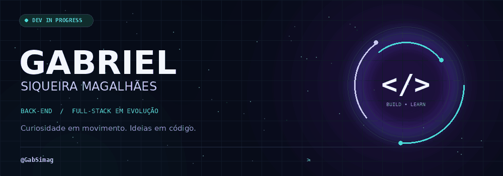
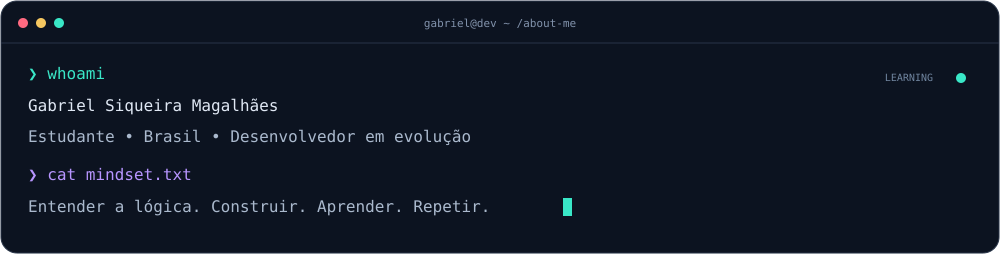
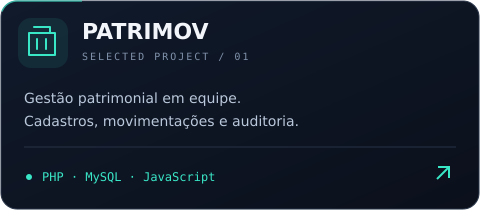
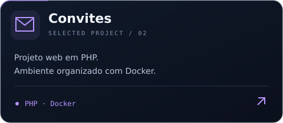
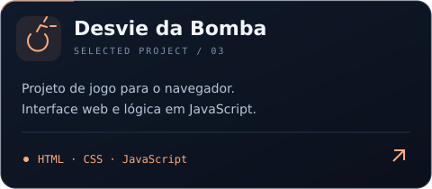

  <picture>
    <source media="(prefers-reduced-motion: reduce)" srcset="./assets/profile/hero-static.png" />
    
  </picture>

  <a href="#projetos">🚀 <b>Projetos</b></a> &nbsp; / &nbsp;
  <a href="#stack">🧬 <b>Tecnologias</b></a> &nbsp; / &nbsp;
  <a href="mailto:gabrielsm1153@gmail.com">✉️ <b>Contato</b></a> &nbsp; / &nbsp;
  <a href="https://instagram.com/gabs.sima">📸 <b>Instagram</b></a>

 

<h2 id="projetos">🚀 Projetos em destaque</h2>

Do desenvolvimento de sistemas às experiências no navegador: um pouco do que estou construindo e explorando.

<table>
<tr>
<td width="50%"></td>
<td width="50%"></td>
</tr>
<tr>
<td width="50%"></td>
<td width="50%"></td>
</tr>
</table>

<a href="https://github.com/GabSimag?tab=repositories"><b>Explorar todos os repositórios ↗</b></a>

 

<h2 id="stack">🧬 Tecnologias em órbita</h2>

Ferramentas presentes nos meus projetos e estudos. Cada uma, um novo jeito de resolver problemas.

<b>DESENVOLVIMENTO &amp; ESTUDOS</b>

   &nbsp; 
   &nbsp; 
   &nbsp; 
   &nbsp; 
   &nbsp; 
   &nbsp; 

JavaScript · TypeScript · PHP · Python · Java · C++

 

<b>INTERFACES, DADOS &amp; VERSIONAMENTO</b>

   &nbsp; 
   &nbsp; 
   &nbsp; 

React · MySQL · Git

<h2>🐍 Um commit de cada vez</h2>

Experimentar, errar, entender e melhorar. A evolução vai deixando seu rastro.

  

<b>📊 Abrir telemetria do GitHub</b>

 

 

<b>O próximo nível começa com a próxima ideia.</b> Tem um projeto, uma dúvida ou uma ideia? Vamos conversar.

<a href="mailto:gabrielsm1153@gmail.com"><b>✉️ E-mail</b></a> &nbsp; · &nbsp; <a href="https://instagram.com/gabs.sima"><b>📸 Instagram</b></a>

